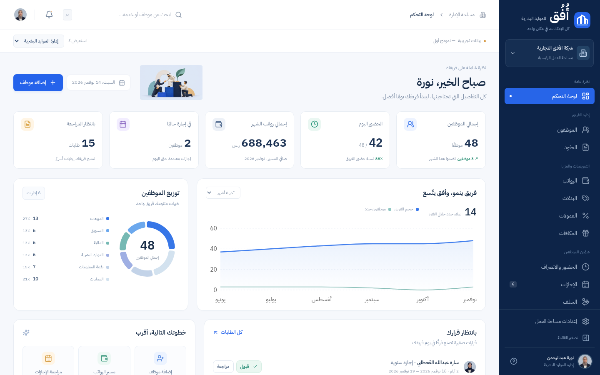
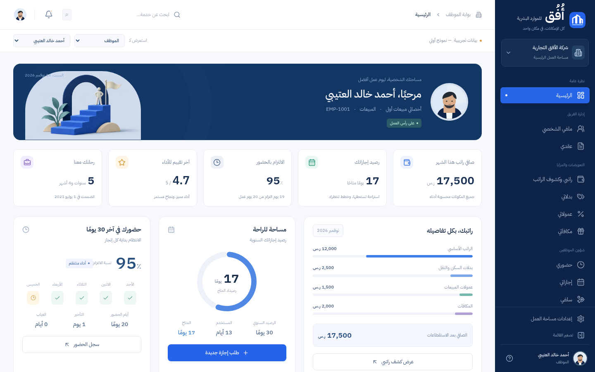

# أفق | Ofuq HRMS Prototype

نموذج ويب تفاعلي باللغة العربية وبتخطيط RTL لشركة الأفق التجارية. صُمّم للعرض على الإدارة وجمع الملاحظات، مع بيانات افتراضية محفوظة في المتصفح.

Arabic RTL HRMS prototype built with React, TypeScript and Vite. Includes 15 HR modules, an employee portal, payroll, sales commissions, and approval workflows. Frontend only, with fictional data stored in the browser.

## العرض المباشر

[افتح نموذج أفق على الإنترنت](https://ofuq-hrms-aswailem195.fineguide4.chatgpt.site)

الرابط متاح للمشاركة. جميع البيانات افتراضية، وتُحفظ تغييرات كل زائر في متصفحه فقط دون مزامنتها مع الزوار الآخرين.

## معاينة الواجهة





[دليل الموظفين](screenshots/employee-directory.png) · [العمولات](screenshots/commissions.png) · [الصور الشخصية المولدة](screenshots/avatars-preview.png)

## التشغيل

يلزم Node.js 20.19 أو أحدث، مع npm.

```bash
git clone https://github.com/aswailem195/ofuq-hrms-prototype.git
cd ofuq-hrms-prototype
npm install
npm run dev
```

افتح **http://localhost:5173**. بعد تثبيت الحزم، يمكنك أيضًا تشغيل المشروع باستخدام `./start.sh`. للإنتاج التجريبي المحلي:

```bash
npm run build
npm run preview
```

يفتح العرض المبني عادة على **http://localhost:4173**. جميع المسارات تعمل عبر React Router ويمكن تحديثها مباشرة مع خادم Vite أو خادم يدعم إعادة توجيه المسارات إلى `index.html`.

## ما الذي يتضمنه النموذج؟

- لوحة إدارة، وبوابة موظف مستقلة، ومفتاح أدوار دائم: الموارد البشرية، مدير القسم، الموظف، والمالية.
- 15 قسمًا: لوحة التحكم، الموظفون، العقود، الرواتب، البدلات، العمولات، المكافآت، الحضور والانصراف، الإجازات، السلف، العهد، التقييمات، الترقيات، الشكاوى، ونهاية الخدمة.
- دليل موظفين قابل للبحث والترشيح، إضافة موظف، وملف مفصل بتبويبات.
- طلب إجازة، مراجعة واعتماد أو رفض، وتحديث الرصيد من حالة الطلب نفسها.
- كشوف رواتب لـ12 شهرًا، تفاصيل المكونات، وتصدير CSV والطباعة أو الحفظ PDF من نافذة المتصفح.
- عمولات مبيعات مع حساب المبلغ من قيمة الصفقة والنسبة، مرشحات شهر وموظف، وحالة صرف مشتركة بين الإدارة والموظف.
- نماذج سلف وشكاوى، سجل حالة وتعليقات، ومتابعة موحدة بين الأدوار.
- تفاصيل العقود ومرفقات توضيحية، دورة التقييم والأهداف، الترقيات، العهد، وخطوات إخلاء الطرف.
- تخصيص اسم الشركة والعملة، إشعارات، بحث شامل، وحالات نتائج فارغة.
- خط عربي وأصول بصرية محلية، و12 صورة شخصية فوتوغرافية المظهر مولدة لشخصيات افتراضية، وقائمة يمين قابلة للتصغير، واستجابة للهواتف والأجهزة اللوحية.

## عرض خلال خمس دقائق

1. **الدقيقة الأولى:** افتح لوحة الإدارة على شاشة 1440×900. استعرض المؤشرات، الرسم البياني، قائمة الموافقات، ثم دليل الموظفين وملف أحد الزملاء.
2. **الثانية:** افتح «العمولات»، واختر نوفمبر 2026 والموظف أحمد خالد العتيبي. افتح عملية وشاهد المبلغ المؤهل والنسبة والحالة.
3. **الثالثة:** من مفتاح الدور اختر «الموظف». لاحظ بيانات أحمد وملخص راتبه ورصيد الإجازة البالغ 17 يومًا. افتح «إجازاتي» وقدّم إجازة من 22 إلى 24 نوفمبر مع السبب.
4. **الرابعة:** بدّل إلى «مدير القسم»، وافتح الإجازات واعتمد الطلب الجديد. ارجع إلى الموظف؛ يظهر الطلب «معتمد» ورصيد 14 يومًا. حدّث الصفحة لتأكيد استمرار البيانات.
5. **الخامسة:** افتح «راتبي وكشوف الراتب»، اختر الشهر، واعرض الكشف. زر «طباعة / حفظ PDF» يفتح نافذة الطباعة. يمكنك استعراض طلب سلفة أو شكوى وسجل معالجته بالطريقة نفسها.

## إعادة بدء العرض

افتح «إعدادات مساحة العمل» ثم «إعادة ضبط البيانات التجريبية» وأكّد الإجراء. تُحذف تعديلات العرض في هذا المتصفح وتعود البيانات إلى الحالة الأصلية. لا يلزم حساب أو كلمة مرور.

## حدود النموذج

هذا **Prototype غير إنتاجي**. لا يوجد Backend أو قاعدة بيانات أو تكامل مالي أو إرسال رسائل أو صلاحيات أمنية حقيقية. مفتاح الدور أداة للعرض؛ بيانات الموظف تُرشّح في واجهته، لكن ذلك ليس حدًا أمنيًا. المستندات توضيحية، وكل المبالغ افتراضية ولا تطبق قواعد قانونية أو تأمينية. حساب أيام الإجازة يشمل أيام الفترة المختارة لأغراض العرض فقط. التاريخ المرجعي ثابت: **14 نوفمبر 2026**. التخزين المحلي يخص المتصفح والجهاز الحاليين، ولا يتزامن بينهما.

لا يحوّل زر الصرف التجريبي أموالًا، ولا يرسل الاعتماد إشعارًا خارج التطبيق. الطباعة تستخدم نافذة المتصفح، ويختار المستخدم حفظ PDF منها.

## الملفات الأساسية

- `DESIGN_PLAN.md`: خريطة المنتج، الرحلات، والنظام البصري.
- `src/App.tsx`: الهيكل العام والقائمة والمسارات والأدوار والإعدادات.
- `src/Pages.tsx`: لوحتا الإدارة والموظف، الموظفون، الإجازات، الرواتب، والعمولات.
- `src/Modules.tsx` و`src/modules.css`: الصفحات الداخلية المتخصصة.
- `src/types.ts` و`src/data.ts` و`src/store.tsx`: نماذج البيانات، البيانات المركزية، وحفظ الحالة.
- `src/components/ui.tsx`: المكونات المشتركة والنوافذ والتبويبات.
- `src/styles.css`: نظام التصميم والاستجابة والطباعة.
- `public/assets/`: الخط المحلي، العلامة، الصور الرمزية، والرسوم الأصلية.
- `tests/hrms.spec.ts`: اختبارات رحلات الاستخدام والمسارات والاستجابة.
- `screenshots/`: لقطات العرض النهائية للإدارة والموظف والعمولات والكشف والهاتف والجهاز اللوحي.
- `output/pdf/payslip-sample.pdf`: كشف تجريبي من صفحة A4 واحدة للتحقق من الطباعة.
- `QA_REPORT.md`: نتائج اختبارات التسليم وحدود التحقق.
- `REFERENCE_NOTES.md`: المراجع والتراخيص وقرارات الاقتباس التصميمي.

## الاختبارات

```bash
npx playwright install chromium
npm test
```

يستخدم إعداد الاختبار Chromium المحلي إن كان موجودًا، وإلا يستخدم متصفح Playwright المثبت. يبدأ خادم Vite تلقائيًا عند الحاجة. تشمل الاختبارات: المسارات، طلب واعتماد إجازة واستمرار الرصيد، إضافة موظف، كشف الراتب والطباعة، مشاركة حالة العمولة، وأحجام 1440×900 و1024×768 و390×844.

## النشر على Vercel

يتضمن المشروع إعدادات Vercel في `vercel.json`: إطار Vite، وأمر البناء `npm run build`، ومجلد الإخراج `dist`، وإعادة توجيه المسارات الداخلية إلى `index.html` لدعم تحديث الصفحات مباشرة.

يمكن استيراد مستودع `aswailem195/ofuq-hrms-prototype` في Vercel والنشر بالإعدادات الافتراضية للمشروع. لا توجد قاعدة بيانات أو متغيرات بيئة مطلوبة. يستثني `.vercelignore` الملفات المؤقتة والمراجع ولقطات العرض من حزمة النشر.

المصدر: [دليل Vite الرسمي على Vercel](https://vercel.com/docs/frameworks/frontend/vite).

## تنظيف الملفات المؤقتة

```bash
npm run clean
```

يحذف هذا الأمر مجلد البناء `dist/` وتقارير الاختبارات `playwright-report/` و`test-results/` والمجلد المؤقت `tmp/` وملف `tsconfig.tsbuildinfo`. يحتفظ بالمصادر والحزم المثبتة ولقطات العرض وملف PDF. يمكنك أيضًا تشغيله مباشرة باستخدام `node scripts/clean.mjs`.

## التحقق المنجز

نجح التثبيت باستخدام npm والبناء باستخدام `npm run build`. نجحت اختبارات Playwright الـ13 على النسخة المبنية، مع مراجعة أحجام 1440×900 و1024×768 و390×844. لم تُرصد أخطاء JavaScript أو طلبات ملفات فاشلة في التقاط التسليم. فُحص كشف PDF بصريًا بعد تحويله إلى صورة، وتأكد ظهوره في صفحة A4 واحدة.

لإعادة التقاط الصور شغّل الخادم على المنفذ 5173، ثم `npm run screenshots`. ينتج السكربت الصور وملف PDF وتقارير الصور المفقودة وأخطاء المتصفح.
